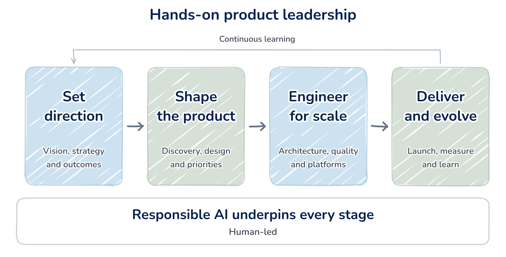

# Salman Abdul Ghaffar — Product Leadership Portfolio

**[Visit the live portfolio →](https://salman.prodmap.co.uk/)**

From complex business problems to products that work at scale.

This is Salman Abdul Ghaffar’s personal portfolio, bringing together product strategy, architecture, large-scale programme management, engineering, quality and service management.

## Explore the work

- [Selected case studies](https://salman.prodmap.co.uk/cases.html): loyalty platforms, internal servicing, digital underwriting, national leave and claims, and document management.
- [My approach](https://salman.prodmap.co.uk/approach.html): philosophy, principles and process.
- [Experience and recommendations](https://salman.prodmap.co.uk/#changelog): career stages, expandable roles and supporting evidence.
- [Capabilities and credentials](https://salman.prodmap.co.uk/specs.html): professional strengths, industry experience, qualifications and tools.

### Hands-on product leadership

## Website structure

The site uses static HTML, CSS and JavaScript and is published through GitHub Pages on a custom domain.

| Location | Purpose |
|---|---|
| `index.html` | Homepage |
| `case-*.html` | Individual case studies |
| `case.html` | Compatibility route for earlier case links |
| `approach.html` | Product leadership approach |
| `specs.html` | Capabilities and credentials |
| `content/site.js` | Public portfolio content |
| `assets/` | Styles, interactions, illustrations, logos and downloadable CV |

The repository is public so the implementation can be inspected and the work traced to its author. Private planning records and original CV evidence are maintained separately.

## Attribution and reuse

© 2026 Salman Abdul Ghaffar. Rights in original portfolio content and artwork are reserved. This repository does not grant an open-source licence for reuse.

GitHub’s terms allow public repositories to be viewed and forked on the platform. For permission to reuse original content, artwork or implementation outside those platform rights, use the [Contact section on the portfolio](https://salman.prodmap.co.uk/#contact). When referencing this work, credit **Salman Abdul Ghaffar** and link to [the live portfolio](https://salman.prodmap.co.uk/) or [this repository](https://github.com/salman-prodmap/portfolio).

Company logos, qualification marks, recommendation quotations and other third-party materials retain their respective owners’ rights. Their inclusion does not grant reuse rights or imply endorsement of this website by those organisations.

## Contact

[Contact Salman](https://salman.prodmap.co.uk/#contact) · [Live portfolio](https://salman.prodmap.co.uk/)
